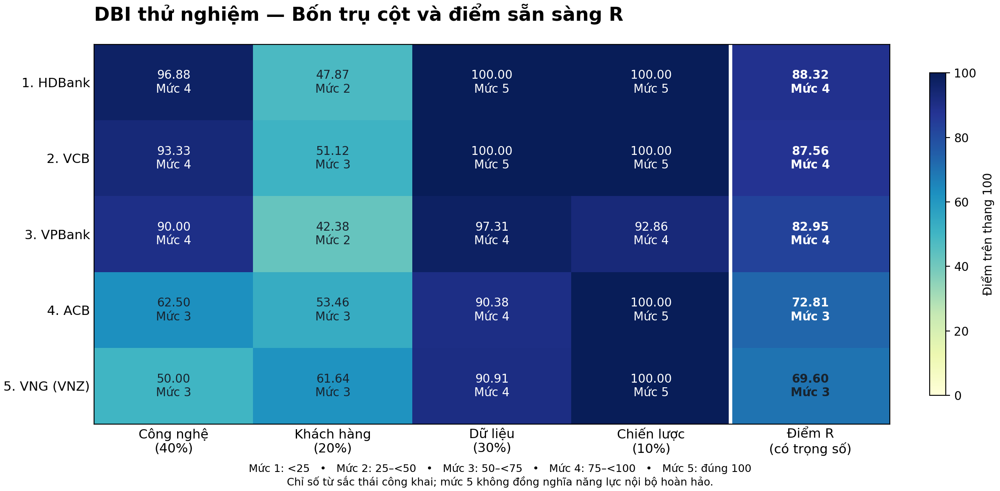

# DBI bốn trụ cột — điểm sẵn sàng R

Đã bỏ Vận hành ngay từ bước gán nhãn và chạy lại trên dữ liệu hiện có. Mỗi trụ cột dùng thang 0–100. R là trung bình có trọng số, không chia thêm cho 4.

R = (Công nghệ × 40 + Khách hàng × 20 + Dữ liệu × 30 + Chiến lược × 10) / 100

| Hạng | Công ty | Công nghệ | Khách hàng | Dữ liệu | Chiến lược | R | Phân mức |
|---|---|---:|---:|---:|---:|---:|---|
| 1 | HDBank | 96.88 | 47.87 | 100.00 | 100.00 | 88.32 | 4 — Mức nâng cao |
| 2 | VCB | 93.33 | 51.12 | 100.00 | 100.00 | 87.56 | 4 — Mức nâng cao |
| 3 | VPBank | 90.00 | 42.38 | 97.31 | 92.86 | 82.95 | 4 — Mức nâng cao |
| 4 | ACB | 62.50 | 53.46 | 90.38 | 100.00 | 72.81 | 3 — Mức phát triển |
| 5 | VNG (VNZ) | 50.00 | 61.64 | 90.91 | 100.00 | 69.60 | 3 — Mức phát triển |

Ngưỡng: Mức 1 cơ bản [0,25); Mức 2 đang phát triển [25,50); Mức 3 phát triển [50,75); Mức 4 nâng cao [75,100); Mức 5 dẫn đầu đúng 100. Phân mức theo số chưa làm tròn.

## Độ phủ chung

| Trụ cột | Chỉ tiêu dùng / định nghĩa | Độ phủ |
|---|---:|---:|
| Công nghệ | 2/3 | 66.67% |
| Khách hàng | 3/3 | 100.0% |
| Dữ liệu | 1/3 | 33.33% |
| Chiến lược | 1/3 | 33.33% |

## Giới hạn và kiểm soát

Điểm phản ánh sắc thái văn bản công khai, không phải kiểm định năng lực nội bộ. Các mức 1–5 là quy ước dự án do người dùng xác định. Điểm trụ cột bằng 100 có thể do toàn bộ tín hiệu quan sát đều dương, không chứng minh năng lực toàn diện.

Giữ quy tắc một quote/chỉ tiêu/trụ cột, loại trùng chính xác và trùng gần, trung bình theo tài liệu và chia đều các nhóm nguồn trong từng chỉ tiêu; chỉ dùng tập ô chung cho năm công ty. Không có dữ liệu không tự nhận 0 hoặc 50. Xem diagnostics/unique_signals.csv để truy vết. Review chỉ dùng cho Khách hàng; VNG bao gồm ZaloPay. Nguồn 2 vẫn là pilot đã có toàn văn, chưa phải toàn kho.

Kết quả cùng Mức 4 vẫn có thể khác hạng theo R; không ép năm công ty vào đủ năm mức. Thiếu dữ liệu hoặc điểm tập trung gần trần có thể làm thứ hạng kém ổn định. Giữ nguyên các output phiên bản trước.